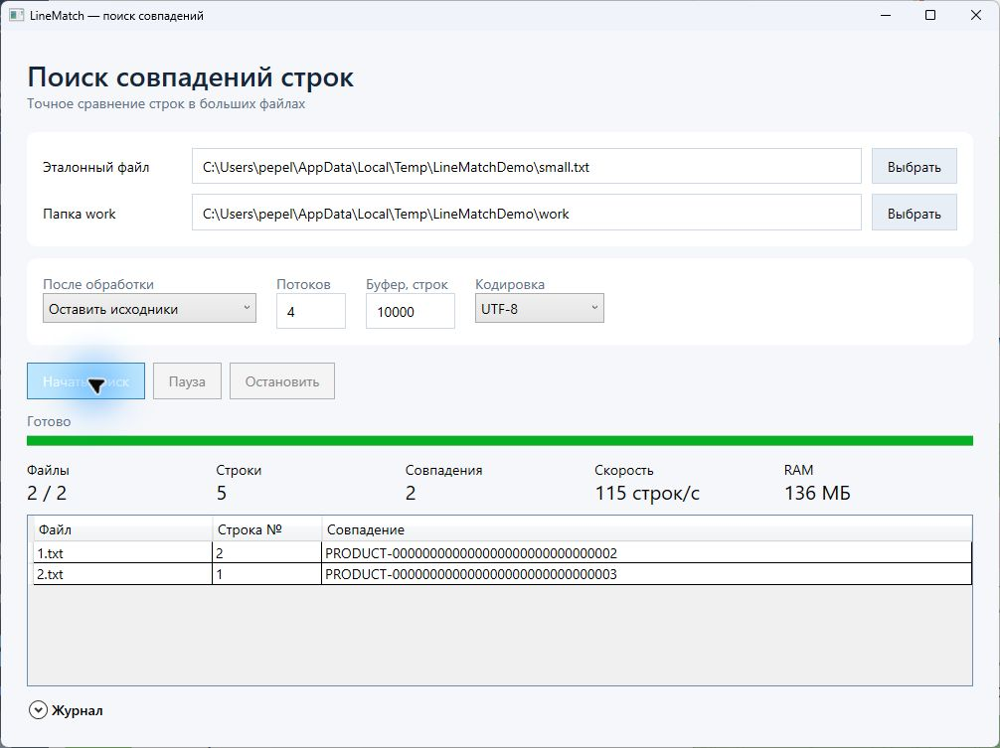
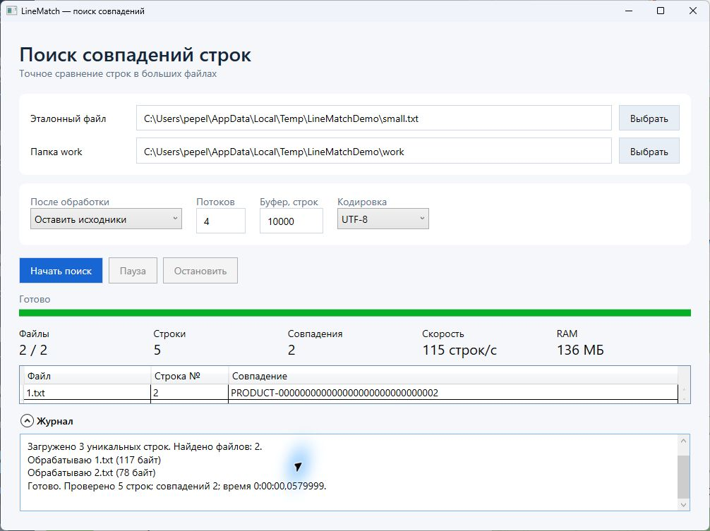

# LineMatch

Демонстрационный Windows-прототип для поиска точных совпадений строк между `small.txt` и набором больших файлов `1.txt`, `2.txt` и далее.

## Скриншоты





## Что работает

- Загрузка эталонных строк в `HashSet<string>` один раз перед запуском.
- Последовательная обработка файлов в числовом порядке; потоковое чтение входных файлов и параллельная проверка ограниченных блоков строк.
- Точное сравнение с учётом регистра, вывод файла и номера строки. `success.txt` создаётся только при первом совпадении.
- Прогресс, число проверенных строк и совпадений, скорость, использование RAM, журнал.
- Пауза, продолжение, остановка; режимы оставить, переместить в `processed`, удалить после **успешного** чтения файла.
- Настройки путей, потоков, размера блока и кодировки в `config.json`. Режим удаления намеренно не восстанавливается.

## Быстрый запуск

Требуется Windows 10/11 и .NET 8 Desktop Runtime. Для сборки — .NET 8 SDK.

```powershell
dotnet run --project src/LineMatch/LineMatch.csproj
```

В интерфейсе выберите `demo/small.txt` и папку `demo/work`, оставьте режим «Оставить исходники» и нажмите «Начать поиск». Два совпадения появятся в таблице и в `demo/success.txt`. Перед повторным запуском перенесите или удалите предыдущий `success.txt`: программа не перезаписывает результаты молча.

Проверка логики:

```powershell
dotnet run --project checks/LineMatch.Checks/LineMatch.Checks.csproj -c Release
```

## Ограничения прототипа

Кодировка выбирается вручную: UTF-8, UTF-16 LE или UTF-16 BE; BOM распознаётся автоматически. Автоопределение кодировки без BOM и Windows-1251 пока не реализованы. В таблице показываются первые 10 000 совпадений, полный результат записывается в файл. Прогресс внутри файла приблизительный из-за буферизации чтения. Испытание на 22 млн эталонных строк и файлах 15 ГБ требует отдельного стенда и измерения памяти и скорости; здесь проведена функциональная проверка на малых файлах.

При ошибке чтения или остановке текущий файл сохраняется. Уже полностью обработанные файлы могут быть перемещены или удалены согласно выбранному режиму. Режим удаления требует явного выбора и подтверждения перед запуском.
